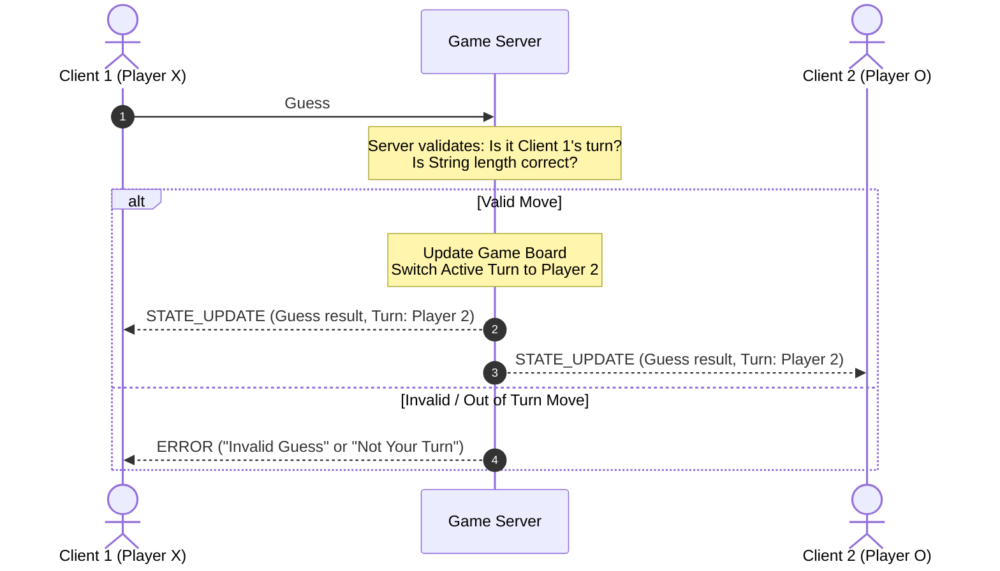

***NEED TO UPDATE TO MY SPECS***

I think im going to use Option B: Non-Blocking I/O Multiplexing (selectors / select.select)
    The server sets client sockets to non-blocking mode (sock.setblocking(False)).
    An OS event loop monitors read/write availability across all sockets within a single thread.

This may keep clean states and ensure we easily handle player 1 and 2 no need to have a thread for this type of game need to confirm still.